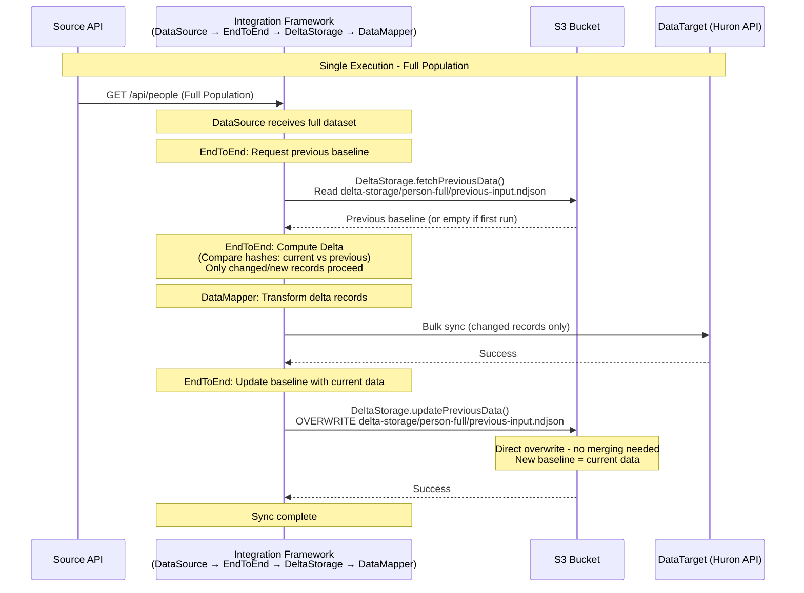
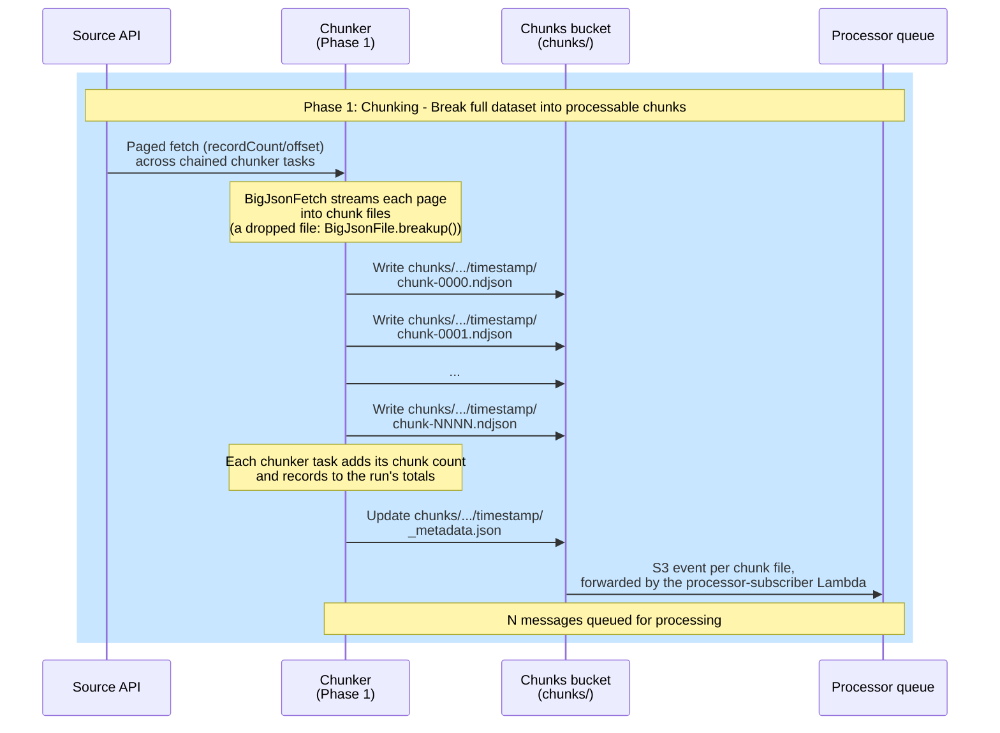
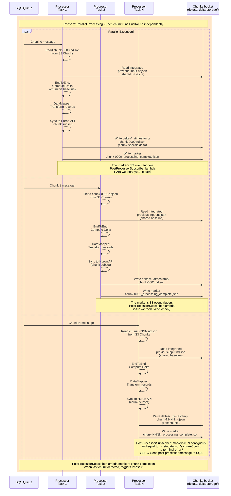
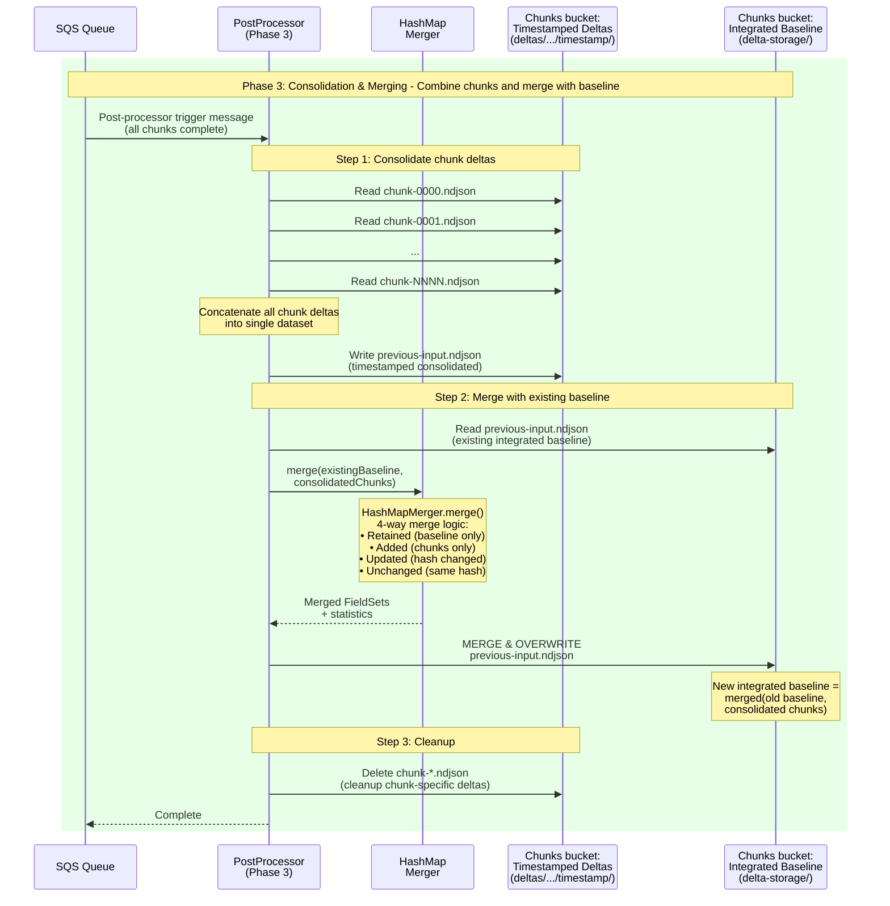

# Post-Processing Delta Storage Merging

This document explains how the pipeline's phases merge delta storage in **S3 storage mode** (`PREVIOUS_STORAGE_TYPE: s3`). The merge step consolidates the chunked delta outputs - each representing a subset of the overall person population - from parallel processing into a single baseline file that is merged with the previous baseline. The code is in `src/post-processing/PostProcessorForS3.ts` and `MergeEngine.ts`; this directory (`lib/services/`) holds the three services' CDK constructs (Fargate services, task definitions, subscriber Lambdas).

**DynamoDB storage mode** (`PREVIOUS_STORAGE_TYPE: dynamodb`, what the landscapes' contexts currently deploy) merges nothing: the processors write the PersonCurrentState and PersonHistory tables directly, the last processor queues the post-processor itself, and the post-processor only runs the deferred deletes (deactivations) and writes the run summary. See [docs/STORAGE_MODES.md](../../docs/STORAGE_MODES.md).

In both modes, Phase 3 also runs the deferred deletes and writes the run's `RUN_SUMMARY`; the diagrams below leave those out.

## Overview

When the chunked processing triggers the "EndToEnd" flow, that EndToEnd module "believes" it is processing a full sync and is only being called once for the entire sync operation, for the entire person population returned by original call tothe source system.
But the processing of the data source is actually scoped to just the chunk file, representing a subset of the overall person population, and the "EndToEnd" flow is called once per chunk, with each chunk having its own isolated delta storage that it reads from and writes to.

When the "EndToEnd" flow executes the DeltaStorage.updatePreviousData method, it won't be be overwriting a global previous-input.ndjson file, but instead writing to a chunk-specific, unique delta storage path derived from the chunk ID (as part of parallel processing). Thus, no prior state is ever actually being overwritten, though we let the "EndToEnd" flow maintain the illusion that it is doing so.

What this means is that the "previous-input.ndjson" files written by each chunk are actually just intermediate outputs that represent the delta state for that chunk, and not the true baseline for the entire sync operation. The true baseline is only created after all chunks have completed and their outputs are consolidated together in this post-processing merging step.

## Architecture Diagrams

The following diagrams illustrate two modes: a single, unchunked sync as integration-huron-person runs it on its own (sequential processing), and this pipeline's chunked sync in S3 storage mode (parallel processing). In the pipeline, one chunks bucket holds everything under its prefixes: `chunks/`, `deltas/` and `delta-storage/` (the shared baseline, `delta-storage/previous-input.ndjson`).

### 1. Non-Chunked Sync (Sequential Processing - No Merging Required)



### 2. Chunked Sync, S3 Storage Mode (Parallel Processing - Merging Required)

#### Overview Diagram 
Note: Each loop of "Phase 2" is essentially the same unchunked process depicted above, injected into a wrapper for parallel execution.

<i>(see detailed sequence diagrams below for each phase further down)</i>

```mermaid
sequenceDiagram
    participant API as Source API
    participant Chunker as Chunker<br/>(Phase 1)
    participant S3Chunks as Chunks bucket<br/>(chunks/)
    participant SQS as Processor queue<br/>(via processor-subscriber Lambda)
    participant Processor as Processor<br/>(Phase 2)
    participant S3Delta as Chunks bucket<br/>(deltas/, delta-storage/)
    participant PostProcessor as PostProcessor<br/>(Phase 3)
    
    rect rgb(200, 230, 255)
    Note over API,SQS: Phase 1: Chunking
    API->>Chunker: Paged fetch of the population<br/>(BigJsonFetch; or a dropped file, BigJsonFile)
    Chunker->>S3Chunks: Write N chunk files
    S3Chunks->>SQS: Each chunk file's S3 event<br/>(forwarded by processor-subscriber Lambda)
    end
    
    rect rgb(255, 230, 200)
    Note over SQS,S3Delta: Phase 2: Parallel Processing (N tasks)
    loop For each chunk
        SQS->>Processor: Chunk message
        Processor->>S3Chunks: Read chunk file
        Processor->>S3Delta: Read shared baseline
        Processor->>Processor: EndToEnd: Compute Delta<br/>Map & Sync to Huron API
        Processor->>S3Delta: Write chunk-specific delta
    end
    end
    
    rect rgb(230, 255, 230)
    Note over SQS,PostProcessor: Phase 3: Consolidation & Merging
    SQS->>PostProcessor: All chunks complete<br/>(post-processor-subscriber Lambda queues the trigger)
    PostProcessor->>S3Delta: Read & consolidate all chunk deltas
    PostProcessor->>S3Delta: Read existing integrated baseline
    PostProcessor->>PostProcessor: HashMapMerger:<br/>4-way merge logic
    PostProcessor->>S3Delta: Write new integrated baseline
    PostProcessor->>S3Delta: Cleanup chunk deltas
    end
```

#### Phase 1: Chunking (Detail)



#### Phase 2: Parallel Processing (Detail)



#### Phase 3: Consolidation & Merging (Detail)



## Key Differences

### Non-Chunked Mode
- **Single execution**: One EndToEnd run for entire population
- **No merging**: Direct overwrite of previous-input.ndjson
- **Simple delta**: Current data becomes new baseline
- **No consolidation**: Single data source, single output

### Chunked Mode (S3 storage)
- **Parallel execution**: N EndToEnd runs (one per chunk)
- **Merging required**: HashMapMerger combines old baseline with new consolidated chunks
- **4-way merge logic**: Tracks retained, added, updated, and unchanged records
- **Two-stage delta**: 
  1. Chunk-specific deltas (intermediate, timestamped)
  2. Integrated baseline (final, shared across all syncs)
- **Consolidation phase**: Post-Processor (Phase 3) combines all chunk outputs before merging with baseline
- **Concurrent completion detection**: PostProcessorSubscriber lambda reacts to each processor's completion marker (`chunk-NNNN_processing_complete.json`) to detect when all chunks are complete

### Chunked Mode (DynamoDB storage)
- **Parallel execution**: N runs, one per chunk, as above
- **No merging or consolidation**: processors write the PersonCurrentState and PersonHistory tables directly
- **Completion detection**: the last processor (by the chunk statuses in the statistics table) queues the post-processor
- **Phase 3**: deferred deletes (deactivations) and the run summary only
