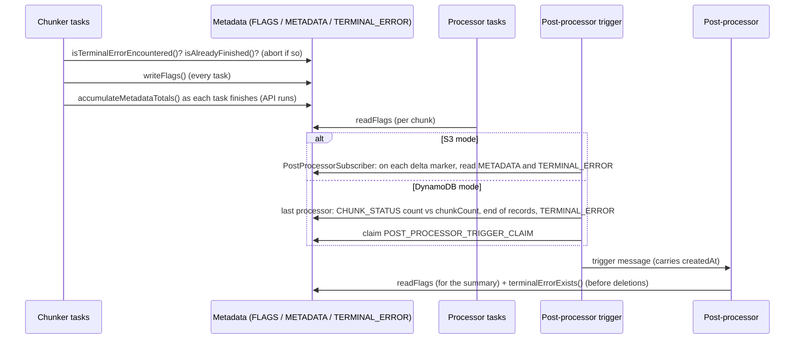

# Run Metadata

Each run (a "sync run", identified by its syncRunId, the ISO timestamp in its chunk directory
`chunks/<population>/<syncRunId>/`) keeps a small amount of state beside its chunk files. This folder reads and
writes it, in either storage mode:

- **FLAGS**: the run's settings, written before chunking so processors can read them: `bulkReset`,
  `trustPreviousStorage`, `syncPopulation`, and per run `personRecordProcessorAddons`, `termsEndpoint`, `startedBy`,
  `processorScalingCapacity`.
- **METADATA**: the run's manifest (`source`, `target`, `chunkDirectory`, `itemsPerChunk`, `createdAt`, ...) and its
  running totals: `chunkCount`, `totalRecords` and `partialOrEmptyChunkEncountered` ("end of source records
  detected"; the name is persisted, so it stays). These totals are how completion is judged.
- **TERMINAL_ERROR**: a marker that the run failed during chunking.

Plus two claim records (below) that make sure something happens once per run. Chunk files themselves are always in S3,
in both modes.

| | S3 mode | DynamoDB mode |
|---|---|---|
| FLAGS | `<chunkDirectory>/_flags.json` | statistics table, SK `FLAGS` |
| METADATA | `<chunkDirectory>/_metadata.json` | statistics table, SK `METADATA` |
| TERMINAL_ERROR | `<chunkDirectory>/_terminal_error.json` | statistics table, SK `TERMINAL_ERROR` |
| Claims | statistics table | statistics table |

The statistics table's partition key is the syncRunId. The table itself is described in
[docs/STATISTICS_TABLE.md](../../../docs/STATISTICS_TABLE.md).

## Classes

- **`IMetadataStorage`** (`IMetadataStorage.ts`, with the `Flags`, `ChunkMetadata`, `TerminalError` and parameter
  types): `write`, `writeFlags`, `read`, `readFlags`, `markRunFailed`, `isRunFailed`, `terminalErrorExists`,
  `readTerminalError`, `readFlagsFromChunkKey`, `readFromChunkKey`, `claimProcessorBoost`, `releaseProcessorBoostClaim`,
  `accumulateMetadataTotals`, `recordRunFailure`.
- **`MetadataForS3`** and **`MetadataForDynamoDb`**: the two implementations. In DynamoDB mode the records go through
  `StatisticsTable` (`writeMetadata`, `writeFlags`, `readMetadata`, `readFlags`, `writeTerminalError`,
  `readTerminalError`, `addToMetadataTotals`, `mergeRunFailure`); writing FLAGS, a terminal error, the totals or the
  run's failure also writes the run's RUN marker (`registerRun()`), which Run history lists runs by.
- **`MetadataFactory.create({ config, previousStorageType?, statisticsTableName?, region?, storage? })`**: picks the
  implementation by `previousStorageType`, else `config.storage.type` (`s3`, `file`, `database` → S3; `dynamodb` →
  DynamoDB, which needs `statisticsTableName`; anything else throws).
- **`MetadataFactoryForBootstrap`** (`createMetadataForBootstrap()`, `readFlagsForBootstrap()`): for code that must read
  a run's state before config is loaded (the processors, post-processors and the post-processor subscriber). It decides
  from the environment: `PREVIOUS_STORAGE_TYPE`, and the person tables' variables
  (`DYNAMODB_PERSON_CURRENT_STATE_TABLE_NAME` / `DYNAMODB_PERSON_HISTORY_TABLE_NAME`), since the statistics table
  exists in both modes.
- **`MetadataBroker`**: one chunk directory's metadata for the chunker (`docker/chunker.ts`, `ChunkFromAPI`,
  `ChunkFromS3`): `write`, `writeFlags`, `markRunFailed`, `isTerminalErrorEncountered()`, `isAlreadyFinished()` (a late
  task aborts once the end of records has been seen), `hasAnyTaskEncounteredPartial()`, `getRunningTotalRecords()` (for
  the `maxTotalRecords` cutoff), and the processor-boost claim.
- **`ChunkFileManager`**: chunk-file operations, S3 in both modes: `listChunkFiles`, `computeTotalRecords` (reads each
  file whole and counts lines), `buildAggregatedMetadata`.
- **`StandardMetadataUtils`** (`MetadataUtils.ts`): path helpers: `deriveDeltaStoragePath` (`chunks/...` →
  `deltas/...`), `deriveChunkDirectory`, `getMetadataKey`, `getFlagsKey`, `getTerminalErrorKey`, `extractSyncRunId`
  (the ISO timestamp anywhere in the key, else the last path segment). `validateMetadata()` there only logs warnings.

## How a run uses it



- **FLAGS** are written by every chunker task (`docker/chunker.ts`). Both modes skip the write if FLAGS exist (S3 mode
  checks for `_flags.json`), so the first task's flags stand; `replace: true` overwrites them.
- **METADATA totals**: in an API run each chunker task adds its own `chunkCount` / `totalRecords` (and the end-of-records
  flag) as it finishes (`accumulateMetadataTotals()`): DynamoDB mode with an `UpdateItem` (`SET if_not_exists` + `ADD`),
  S3 mode with an ETag-conditional rewrite of `_metadata.json` (retried), then a best-effort copy to the statistics
  table. A file-drop run (`ChunkFromS3`) writes METADATA once, after chunking. Counts are never inferred from the
  requested `recordCount`.
- **Completion** is judged from METADATA's totals: in S3 mode by `PostProcessorSubscriber`, when the processors' delta
  markers (`chunk-NNNN_processing_complete.json`) cover `chunkCount`; in DynamoDB mode by the processor that finds every
  chunk's status recorded, which then claims the trigger. Either way the end of records must have been detected.
- **Processors** read the run's Flags: `ProcessorForS3` through `readFlagsFromChunkKey()`, `ProcessorForDynamoDb`
  through `readFlagsForBootstrap()`. They don't check the terminal error while processing a chunk.
- **The post-processor** reads Flags for the run's `RUN_SUMMARY`, and checks `terminalErrorExists()` in
  `runDeferredDeletes()`; it doesn't read METADATA.

## Failure handling

A run fails during chunking when a chunker task hits an unrecoverable error: an unhandled exception in
`docker/chunker.ts`, the source's retries exhausted in `ChunkFromAPI`, or the `maxTotalRecords` safety cutoff
(`BigJsonFetch`), which surfaces through the same path.

- **`markRunFailed({ bucketName?, chunkDirectory, region?, errorMessage? })`** writes the TERMINAL_ERROR marker:
  `{ stage: 'chunking', chunkDirectory, errorMessage?, errorTimestamp }`. `docker/chunker.ts`'s catch block calls it.
- **`ChunkFromAPI`** also merges `runFailed`, `runFailureMessage` and `runFailureTimestamp` into METADATA
  (`recordRunFailure()`) before calling `markRunFailed()`, keeping the totals accumulated so far: S3 mode with the same
  ETag-conditional rewrite of `_metadata.json` as `accumulateMetadataTotals()`, DynamoDB mode with an `UpdateItem`
  (`StatisticsTable.mergeRunFailure()`). These fields are diagnostic only. `ChunkFromS3` writes no failure fields.
- `Flags` declares `runFailed` / `runFailureMessage` / `runFailureTimestamp` and `isRunFailed()` reads them, but nothing
  writes them to FLAGS.

Who checks the marker:

- **Later chunker tasks**: `isTerminalErrorEncountered()` (`terminalErrorExists()`) before starting work; they exit
  with code 1, so no work is wasted on a failed run.
- **Processors**: not while processing a chunk; partial chunks are still processed. Except that in DynamoDB mode the
  processor that finds all chunks complete checks `StatisticsTable.readTerminalError()` and does not trigger the
  post-processor for a failed run.
- **The post-processor trigger**: in S3 mode `PostProcessorSubscriber` blocks the post-processor entirely for a failed
  run.
- **The post-processor**: in both modes `runDeferredDeletes()` checks `terminalErrorExists()` and skips deletion
  handling: a failed run's population is incomplete, so "missing" people must never be deactivated.
- An incomplete run never triggers the post-processor, for want of chunk markers.

More on how chunking ends and fails: [docs/CHUNKING_END_AND_FAILURE.md](../../../docs/CHUNKING_END_AND_FAILURE.md).

## Claim records

**Processor boost claim** (SK `PROCESSOR_BOOST_CLAIM`, attributes `claimedAt`, optional `claimedByChunk`: the chunker
offset, or the input S3 key for a file drop): written by the one chunker task that wins `claimProcessorBoost()`
(`ProcessorServiceBooster`; `OCCFlag`-guarded, first writer wins); deleted by `releaseProcessorBoostClaim()`. Claims
older than 10 minutes are treated as abandoned and cleared. In S3 mode `MetadataForS3` writes the same record to the
statistics table.

**Post-processor trigger claim** (SK `POST_PROCESSOR_TRIGGER_CLAIM`, attributes `claimedAt`, optional
`claimedByChunk`): written directly through `StatisticsTable.claimPostProcessorTrigger()` (not through the metadata
classes) by the one `ProcessorForDynamoDb` task that wins the right to send the post-processor trigger. Never released:
the post-processor is triggered at most once per run.

More on these claims: [docs/CONCURRENCY_CONTROL.md](../../../docs/CONCURRENCY_CONTROL.md).

## Error records

Target API errors during processing are recorded in the statistics table by `ApiErrorTracking`
(`src/ApiErrorTracking.ts`), one item per error, and do not halt the run:

```
PK: "2026-03-03T19:58:41.277Z"
SK: "ERROR:429:2026-03-03T20:01:12.003Z"
Attributes: { errorType: "ERROR:429", timestamp, statusCode: 429, statusText?, message, incidentId?, isThrottled: true, detailsObj? }
```

`errorType` is a GSI key, so errors can be listed by status code. A chunk with errors still finishes; the processor's
exit code comes from `computeExitCode()` (`src/processing/ProcessorCommon.ts`).

## Example S3 files

`chunks/person-full/2026-03-03T19:58:41.277Z/_flags.json`:

```json
{
  "bulkReset": false,
  "trustPreviousStorage": true,
  "syncPopulation": "person-full",
  "startedBy": { "by": "schedule" },
  "processorScalingCapacity": { "maxTasks": 8, "overridden": false }
}
```

`_metadata.json` in the same directory holds the manifest and totals, e.g. `"chunkDirectory":
"chunks/person-full/2026-03-03T19:58:41.277Z"`, `"chunkCount": 735`, `"totalRecords": 146812`,
`"partialOrEmptyChunkEncountered": true`; a file-drop run also lists `chunkKeys`. S3-mode processors write their delta
chunks under the matching `deltas/person-full/2026-03-03T19:58:41.277Z/`.

## Testing

```bash
npm test -- MetadataForDynamoDb MetadataBroker MetadataForS3Totals Metadata.test
```

`test/Metadata.test.ts` covers `ChunkFileManager`; `test/MetadataForDynamoDb.test.ts`, `test/MetadataBroker.test.ts`
and `test/MetadataForS3Totals.test.ts` cover writing and reading, terminal errors and the totals.

## Common issues

- **"Metadata file not found - blocking post-processor until metadata is available"** (`PostProcessorSubscriber`):
  METADATA isn't written yet; normal while chunker tasks are still finishing. Persisting, check the chunker's logs.
- **"No flags file found (chunking may not have started yet)"** (`MetadataForS3`): a reader looked before the first
  chunker task wrote FLAGS; check the chunk directory and the chunker's logs.
- **Post-processor never runs**: look for a TERMINAL_ERROR record, then compare METADATA's `chunkCount` with the delta
  markers (S3) or CHUNK_STATUS items (DynamoDB), and check `partialOrEmptyChunkEncountered`.

## Possible improvements

- Add `validateFlags()`, and make `validateMetadata()` enforce rather than warn.
