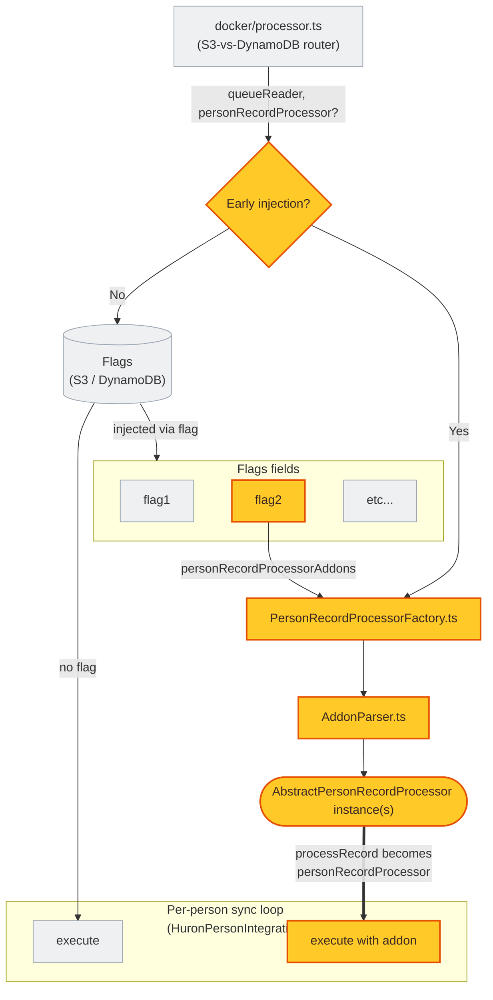
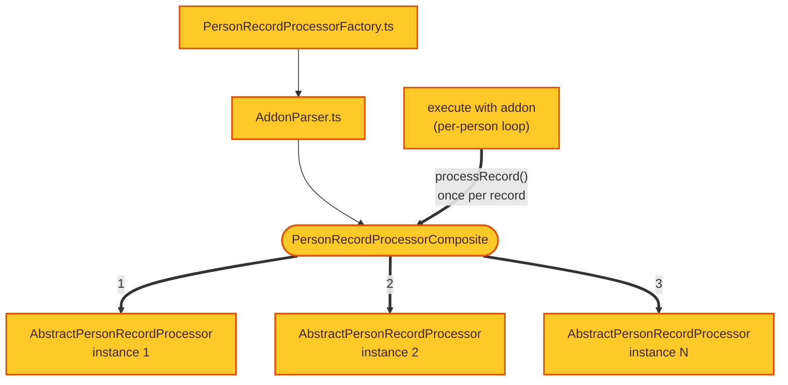
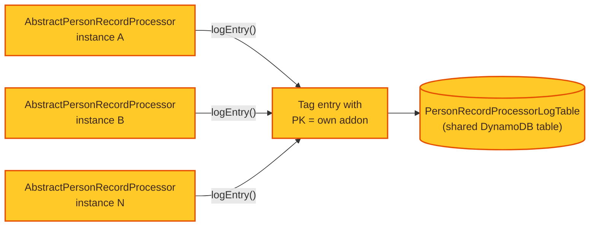

# Person Record Processor Addons

This directory implements a small framework that lets custom, per-person async logic run
during the processor phase of a Huron person sync as addon functionality - without modifying `HuronPersonIntegration` or `DataMapper` in
`integration-huron-person`. It exists to make **implementations pluggable**: any number of
addons can be written here, selected at runtime, and combined, all without
touching the core sync/mapping code.

## Files

| File | Role |
| --- | --- |
| `AbstractAddonPersonProcessor.ts` | `Addon` enum + `AbstractPersonRecordProcessor` base class that every addon extends. |
| `AddonParser.ts` | Parses the comma-delimited configuration string into `Addon` values. |
| `PersonRecordProcessorComposite.ts` | Combines several active addons into one. |
| `PersonRecordProcessorFactory.ts` | Resolves which addon(s) are active and constructs them. |
| `impl/` | Concrete addons live here, one file per addon. |

## Use of dependency injection


<span style="display:inline-block;width:10px;height:10px;background:#eef0f2;border:1px solid #9aa5b1;"></span>&nbsp;**Standard processor phase** - Plumbing that exists regardless of this framework.&nbsp;&nbsp;&nbsp;<br><span style="display:inline-block;width:10px;height:10px;background:#ffca28;border:1px solid #e65100;"></span>&nbsp;**Dependency injection** - The machinery this directory adds to inject custom per-person logic into the sync process.




`HuronPersonIntegration` (in `integration-huron-person`) accepts an optional
`personRecordProcessor` constructor param - a plain callback matching:

```ts
type PersonRecordProcessor = (record: { raw: any, mapped?: FieldSet, error?: unknown }) => Promise<void>;
```

It is invoked once per person record encountered during a sync (success or mapping failure),
regardless of whether the sync as a whole succeeds. `HuronPersonIntegration` has no idea what
this callback does, or how many addons it represents - it's just handed a function.

That function is assembled here and injected at the last possible moment:

1. `docker/processor.ts` (the S3-vs-DynamoDB router) accepts an optional `personRecordProcessor`
   parameter and threads it through to whichever of `ProcessorForS3.ts`/`ProcessorForDynamoDb.ts`
   it routes to.
2. If nothing was injected, each `main()` resolves it itself by reading
   `flags.personRecordProcessorAddons` (see "Selecting which addons run" below for how that Flags
   field is populated) and calling `personRecordProcessorFactory(...)`.
3. The resolved `AbstractPersonRecordProcessor` instance's `processRecord` method - which
   already matches the `PersonRecordProcessor` shape - is passed straight into
   `HuronPersonIntegration`.

No addon is ever hard-coded into the processor entry points; which one(s) run is purely
a runtime decision.

**Why the router takes an optional processor**: `docker/processor.ts` accepts an optional
`personRecordProcessor: PersonRecordProcessor` parameter and threads it through to whichever of
`ProcessorForS3.ts`/`ProcessorForDynamoDb.ts`'s `main()` it routes to - both of which also accept
that same optional parameter. If provided (e.g. by a test, or a future caller that already knows
which processor to use), it's used as-is; otherwise each `main()` falls back to resolving it from
its own chunk's Flags via `personRecordProcessorFactory()`. This keeps the factory-invocation logic
from being duplicated across processor variants (DRY), while still allowing Flags-based resolution
to work correctly - the router itself can't resolve from Flags because those are chunk-specific and
not known until deep inside each `main()`.

## Selecting which addons run: Flags, not task-definition env vars

Which addon is active is deliberately **not** an `IContext`/task-definition environment variable
(that would require a full stack redeploy to change). Instead it follows the same
runtime-configuration precedent as `flags.previousStateSource`: a `personRecordProcessorAddons` field
(comma-delimited `Addon` keys) flows through `src/chunking/metadata/IMetadataStorage.ts`'s `Flags`
type, which is written to S3/DynamoDB *before* chunking starts and read back by each processor
task - so it can be changed per-run without redeploying anything. The full path:

1. **Manual invocation** (`src/runner/Runner.ts`, "FOR MANUAL INVOCATION ONLY"): reads the
   `PERSON_RECORD_PROCESSOR_ADDONS` env var via `RunnerTypes.ts`'s `extractEnvironment()` into
   `RunnerEnv.personRecordProcessorAddons`.
2. Each runner (`RunnerForSingleMessage.ts`, `RunnerForSinglePerson.ts`, and
   `RunnerForQueueSeeding.ts` via `QueueSeeder.ts`) copies that value into the `ApiChunkerEvent` it
   sends (`ChunkerSubscriber.ts`'s `ApiChunkerEvent.personRecordProcessorAddons`).
3. **Scheduled production invocation** (the landscape's bulk sync schedule, managed through
   `src/schedule/ScheduledRun.ts`): its input can carry a `personRecordProcessorAddons` field
   (`ScheduledRun.scheduleInput()` takes one), though no schedule sets one yet - the consuming
   side described below already handles it whenever a value is present.
4. `ChunkerApiSubscriber.ts`'s `handleApiEvent()` extracts it from the incoming event and forwards
   it into the `TaskParameters` SQS message it sends to the chunker queue.
5. `ChunkFromAPI.ts` parses it off the queue message into `TaskParameters.personRecordProcessorAddons`
   and exposes it via `getPersonRecordProcessorAddons()`; `ChunkerQueue.ts`'s
   `sendNextChunkingMessage()` re-forwards it into subsequent messages for parallel chunking.
6. `docker/chunker.ts` reads that getter and includes it when calling
   `metadataManager.writeFlags(...)` - so it's persisted to the run's Flags record before any
   processor task starts.
7. `ProcessorForS3.ts`/`ProcessorForDynamoDb.ts` read it back via
   `flags.personRecordProcessorAddons` (from the same `readFlagsFromChunkKey()` call already used
   for `flags.previousStateSource` etc.) and pass it to `personRecordProcessorFactory()`.

`termsEndpoint` and `startedBy` travel the same way (`docs/SOURCE_SIMULATOR.md`, `docs/RUN_START.md`).

## Multi-addon capability



More than one addon can be active for the same sync. `personRecordProcessorFactory`
takes a comma-delimited string (parsed by `AddonParser.ts`), constructs one instance per
valid, de-duplicated addon, and:

- returns `undefined` if none resolved (no-op),
- returns that single instance if exactly one resolved,
- otherwise wraps all of them in a `PersonRecordProcessorComposite`.

Each token in the comma-delimited string may be either an `Addon` enum **key name** (e.g.
`'ORG_COMPARISON_LOGGING'`) or its underlying numeric value as a string (e.g. `'0'`) - both are
accepted so configuration isn't forced to track the enum's internal numbers, while still
allowing a numeric value if that's more convenient for a given caller. Specifying the same
addon twice (whether by name, by number, or one of each) only produces one instance.

`Addon` is a plain (numeric) TS enum with no explicit initializers, so configuration normally
identifies an addon by its enum key name - the underlying number is an implementation detail.
`AddonParser.ts`'s `parseAddons()` tries a token as a number first (matched via the enum's reverse
mapping) only if it looks like an integer; otherwise it's looked up by key name. Mixing both forms
for the same addon in one list (e.g. `'ORG_COMPARISON_LOGGING,0'`) de-duplicates to a single
instance rather than double-counting it. See `test/AddonParser.test.ts` for the full set of parsing
permutations this covers.

`PersonRecordProcessorComposite` is itself an `AbstractPersonRecordProcessor` - it just holds an
array of other instances and, for every record, calls each wrapped instance's `processRecord` in
turn. One addon throwing does not prevent the others from running (the error is caught
and logged). This mirrors the wrapping style used by `src/runner/decorators/` (hold an inner
instance, delegate to it) - composing several instances rather than decorating exactly one.

## Shared log table



Addons that want to persist findings call the inherited
`this.logEntry(this.addon, personid, data)` helper, which writes to a single shared
DynamoDB table. `data` is a free-form JSON blob - its shape is entirely up to each addon.

The table is `src/dynamodb/PersonRecordProcessorLogTable.ts`, with its CDK table in
`lib/DynamoDB.ts` (`personRecordProcessorLogTable`: a single table, with no mock-mode variant).
Schema: PK=`addon` (groups entries by which addon wrote them), SK=`sortKey`
(`${isoTimestamp}#${personid}`, chronologically browsable and collision-free per person), plus the
generic `data` JSON attribute. This lets any number of future addons share one table with zero
CDK/schema changes - only `AbstractAddonPersonProcessor`, `Addon`, and
`PersonRecordProcessorFactory` need updating to add one. The log table's name IS baked into the task
definition as `PERSON_RECORD_PROCESSOR_LOG_TABLE_NAME`: it's an infrastructure resource name, not a
per-run behavioral toggle, so CDK-time baking is appropriate here - unlike *which* addon runs.

## Addons so far

- `impl/OrgComparisonLogging.ts` (`ORG_COMPARISON_LOGGING`): for students - mapped
  `title === 'Student'`, set in integration-huron-person's `src/data-mapper/DataMapperTitle.ts`
  from the *same* `orgAssignments.personType` that drove the `organization`/`secondaryUnit`
  assignment, a more accurate signal than an independent raw `studentInfo` check - whose
  primary/secondary org HRNs differ, it logs `{ personid, primaryOrg, secondaryOrg }`.

The hook itself, `personRecordProcessor`, is documented in integration-huron-person's `CLAUDE.md`
and `src/data-mapper/CLAUDE.md`.

## How to add a new implementation

1. Add a new value to the `Addon` enum in `AbstractAddonPersonProcessor.ts`.
2. Create a new file under `impl/` with a class extending `AbstractPersonRecordProcessor`:
   - set `readonly addon` to your new enum value,
   - implement `processRecord: PersonRecordProcessor = async ({ raw, mapped, error }) => { ... }`,
   - call `this.logEntry(this.addon, personid, data)` to persist any findings.
3. Register the new class in the `switch` in `PersonRecordProcessorFactory.ts`.
4. Activate it by setting `PERSON_RECORD_PROCESSOR_ADDONS` (the env var read by `Runner.ts`; see
   "Selecting which addons run" above for where else the value comes from at runtime), or the
   `personRecordProcessorAddons` Flags field directly, to the enum *key* - comma-delimit multiple
   keys to run several addons together (combined automatically via
   `PersonRecordProcessorComposite`).
