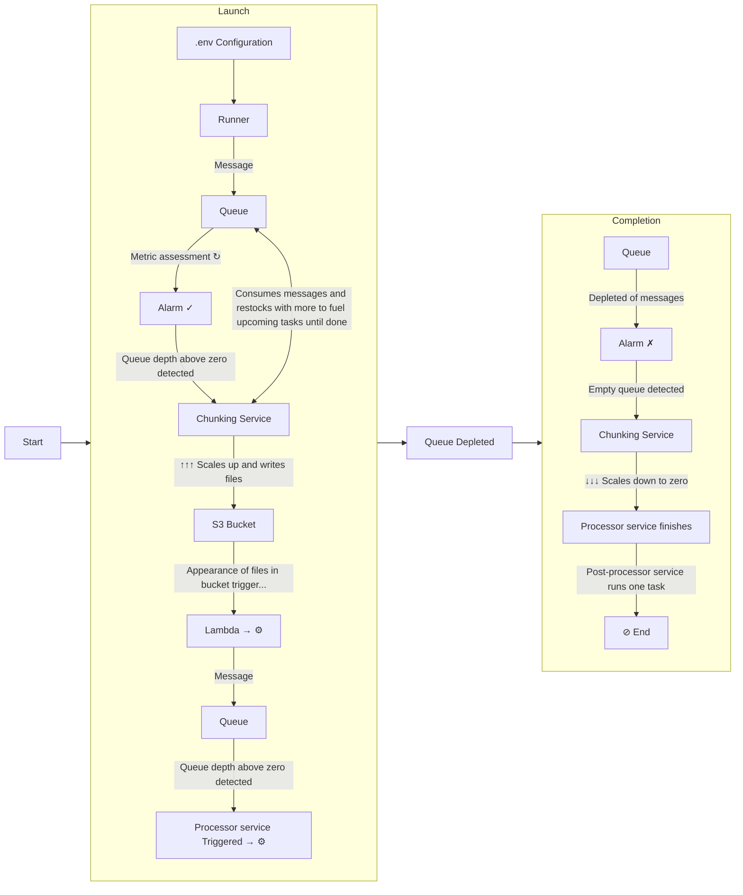

# Integration Runner

## Overview

The integration runner is used to "kick off" an integration run. It can be configured to do so in multiple ways/modes. 

Most modes assume parallel processing.
The fundamental flow common to all modes in parallel processing is depicted below:

Run it with `npx ts-node -r dotenv/config src/runner/Runner.ts` (plain `npx ts-node` doesn't load `.env`) or F5 →
"Debug current file" in VS Code, with its settings in the `RUNNER_` group of `.env`. Before sending anything, it sets the processor service's maximum for the run and resets the
run counters (unless `SKIP_ATOMIC_COUNTER_RESET`), as the chunker subscriber does for a scheduled run or the
dashboard's Bulk sync. The details, every setting and the pitfalls: [CLAUDE.md](./CLAUDE.md).

## Modes of Operation

### Single message (the default)
One message to the chunker queue; the chunker service's auto-scaling adds tasks as the work builds up, each task
chaining the next message. With `DATASOURCE_ENDPOINTCONFIG_ITERATION_LIMIT=0` a single chunker task fetches everything,
with no concurrency in chunking.

### Single person mode (testing)
`SINGLE_PERSON_BUID=U12345678`: one message for that person, through the person endpoint (`?buid=`), so one chunk and
one processor task. Always `person-delta`: leave `POPULATION_TYPE` unset or set it to `person-delta`; anything else is
refused, because a `person-full` run of one person would deactivate everyone else in the target.

### Queue seeding (concurrency from the start)
`MESSAGES_TO_PREPOPULATE=N` seeds the queue with N messages, offsets a task's chunks apart, then (with `DESIRED_COUNT`
above 0) waits for the chunker's scale-in alarm to settle (`MetricsCatchupDelay`) and sets the chunker service's
desired count, so N tasks start at once instead of ramping up. The dashboard's Bulk sync does the same with its
Parallel start.

### Messaging only / chunking only
`MESSAGING_ONLY=true` turns the chunker subscriber off (`DRY_RUN`), to test messages without chunk files;
`CHUNKING_ONLY=true` turns the processor subscriber off, to make chunk files without processing them. Otherwise both
are turned back on. The setting stays on the Lambdas after the run.

### Source simulator
`SOURCE_SIMULATOR=true` (mock landscapes only) reads from the source simulator instead of the real source API, with its
settings (`SOURCE_SIMULATOR_MOCK_*`) sent with the run. It doesn't turn the subscribers back on: they keep whatever
`DRY_RUN` an earlier run left them with, unless `CHUNKING_ONLY` or `MESSAGING_ONLY` sets it.

### Mock landscapes
When `LANDSCAPE` is a mock landscape (`mock`, `mock1`, ...), the Runner checks the mock stack is deployed and, with
`MOCK_TARGET_RESET_STATE=true`, empties its target simulator, statistics and delta baseline first. Hybrid runs (the
real source into a mock landscape) work but consume the real, depleting source API.